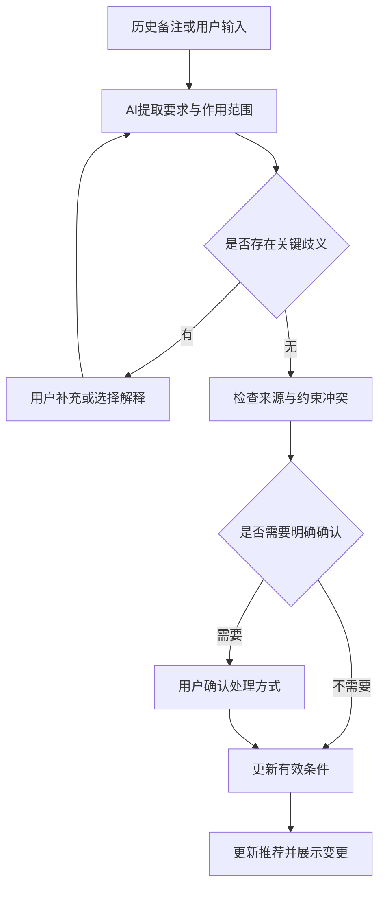
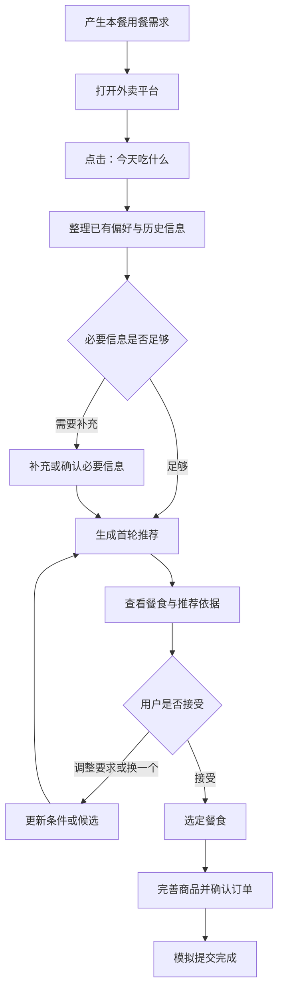
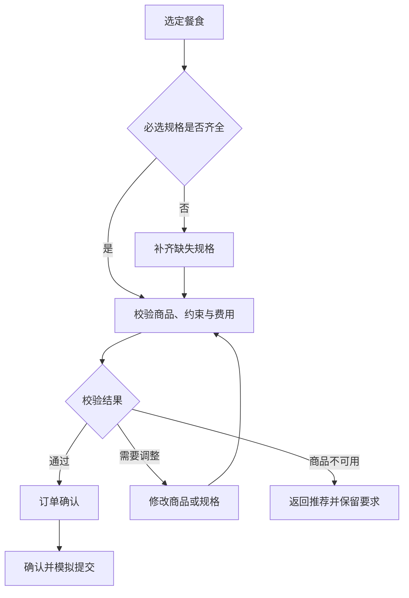

# “今天吃什么”助手：产品、实现验证与提交方案

**产品定位：外卖平台内的个人用餐决策助手。**面向经常为自己选择外卖、具有个人饮食要求且希望减少选择负担的用户，帮助其从表达或沿用要求，走到选定餐食与订单确认。

**当前状态：**需求、产品、实现验证及提交方案已完成设计；Demo制作、真实模型联调和各项测试尚未执行。本文的数量、排序及默认设置为初始方案，正式交付需补齐可运行入口与验证证据。

| 章节 | 回答的问题 |
| --- | --- |
| 一、项目任务与需求定位 | 为谁解决什么问题，题目要求交付什么？ |
| 二、产品范围与功能优先级 | 本次覆盖哪些能力，模拟哪些内容？ |
| 三、需求规则与信息管理 | 如何理解、获得、确认和维护用户要求？ |
| 四、用户旅程与界面结构 | 用户从哪里进入，如何完成一次任务？ |
| 五、推荐生成与结果展示 | 如何筛选、排序、解释及处理无结果？ |
| 六、商品操作与订单承接 | 如何改规格、加菜、确认及保存任务状态？ |
| 七、AI职责与接口设计 | AI处理哪些任务，输出如何校验和执行？ |
| 八、技术实现与数据准备 | 用什么结构实现，准备哪些数据，按什么顺序开发？ |
| 九、验证与验收 | 如何验证规则、完整流程及用户价值？ |
| 十、提交材料与体验指引 | 评审如何开始体验，提交文案如何与成品一致？ |

## 一、项目任务与需求定位

### 1. 题目要求与本次任务

使用AI辅助，将小A的反馈转化为可体验的产品Demo。题目允许调整需求与流程、使用模拟数据，无须对接真实外卖平台，至少一条核心流程能够实际操作。

题目要求提交**可体验的Demo链接或文件，以及核心问题和方案思路的简短说明**。本方案将核心体验定义为：进入助手、沿用或调整要求、获得推荐、选定餐食、完善商品配置、确认并模拟提交。Demo不产生真实订单或付款。

原始反馈涉及口味、食材排除、连续两天避免同一道主菜、少油少炸及尽量有主食，并指出每天反复浏览耗时。小A用于提出需求假设与原始要求验收，具体示例配置需标注演示设定。

### 2. 目标用户

目标用户为：**经常为自己决定外卖吃什么，具有个人饮食偏好或限制，并希望减少选择时间与精力的人。**

“个人选择”指本次只需要处理一人的用餐要求。用户可以独处，也可以与同事、室友共同用餐但各自选择自己的餐食。

当前优先服务希望降低选择负担的用户。将长时间浏览、发现新店作为主要乐趣的用户，以及需要协调多人需求的用户，暂不作为本次优先覆盖对象。

**判断依据与证据边界：**小A提供了这类需求的具体实例，足以支持提出产品假设。现有材料尚未提供用户调研或行为数据，目标群体的规模、需求普遍程度及付费意愿有待验证。

### 3. 核心问题与用户需求

用户的饮食要求分散在多个方面，包括喜欢什么、不吃什么、这一餐有什么要求、最近吃过什么。选择外卖时，用户需要将这些条件逐一应用到候选餐食上，再决定最终吃哪一个。

**核心问题：用户有饮食要求，却仍需投入较多筛选与比较，才能形成可接受的具体用餐决定。**

| 核心需求 | 用户希望获得的帮助 | 产品价值 | 判断依据 |
| --- | --- | --- | --- |
| 找到适合自己的选择 | 排除不接受的内容，找到符合口味与当次要求的餐食 | 减少自行逐项核对的工作 | “按自己的口味”“避开不吃的食材”等表达 |
| 更容易选定这一餐 | 在可接受的候选中完成决定 | 减少反复浏览、犹豫和无效比较 | “不知道点什么”“翻来翻去很费时间” |
| 重复使用省力 | 复用已有要求，容纳今天的变化 | 减少重复输入与重新筛选 | “每天”发生选择任务，并提出跨日重复要求 |
| 选择顺畅进入购买 | 保留已经确定的餐食与规格 | 减少下单前的重复操作 | 平台内产品形态与完整任务路径的方案判断 |

**待验证重点：**用户主要卡在“难以找到符合要求的候选”，还是“候选合适但仍难以决定”，目前证据不足。后续体验应分别观察匹配过程与最终决定过程，以确定优先改进方向。

### 4. 适用情境与影响因素

产品服务一个人为自己选择外卖餐食的任务。午餐、晚餐和办公室、寝室、家中共享偏好匹配与决策支持能力；具体差异通过下列条件进入推荐。

| 情境因素 | 可能影响的条件 | 当前处理原则 |
| --- | --- | --- |
| 时间安排 | 是否需要在某个时间前用餐 | 具体要求由用户表达，不根据餐次或地点自动推断 |
| 预算 | 用户可接受的总价范围 | 展示预估总价，预算上限作为增强项 |
| 分量与餐食构成 | 主食、配菜和份量 | 根据用户要求表达，允许当次变化 |
| 午餐或晚餐 | 当次偏好与相关历史范围 | 利用具体信息调整推荐 |
| 当前配送地址 | 配送范围、预计时间和费用 | 沿用平台当前地址，切换后重新检查 |
| 用餐设施等额外条件 | 餐食适用性 | 有明确影响时补充，当前不主动收集完整场景画像 |
| 近期用餐 | 需要回避的主菜 | 按有效重复规则处理 |

## 二、产品范围与功能优先级

### 1. 推荐单位与订单边界

**以对应具体可售商品的单人餐食或固定套餐为推荐单位。**每项推荐对应一家商家，明确餐食构成及已选、预填和待补选的规格。商品必须确定，必选规格允许在选餐后补齐；进入订单确认前必须全部确定。

| 内容 | 本次范围 |
| --- | --- |
| 商品来源 | 预先整理的模拟商家与商品池 |
| 推荐形式 | 单人餐食、固定套餐及商家提供的可选规格 |
| 规格调整 | 商品实际提供的辣度、份量、主食等选项 |
| 加菜 | 在同一商家增加商品 |
| 组合边界 | 一份订单内的商品来自同一商家 |

**取舍依据：**推荐落实到具体商品才能承接购买；允许规格后补，可以保留用户对份量、主食等选项的选择权。固定套餐与有限规格控制组合复杂度。未选规格的可推荐条件、比较配置与费用口径见第五章，补选与校验见第六章。

### 2. 核心版本

| 能力 | 本次实现范围 | 纳入依据 |
| --- | --- | --- |
| 历史整理与预填 | 模拟订单、备注整理及偏好摘要 | 降低首次设置负担 |
| 偏好确认与编辑 | 查看、纠正、长期保存与删除 | 保证预填可控 |
| 当次自然语言调整 | 在支持的饮食因素内理解并生效 | 体现AI降低表达成本的价值 |
| 地址复用与切换 | 影响模拟供给、时间与费用 | 保证购买上下文有效 |
| 条件筛选与排序 | 执行约束，体现偏好差异 | 推荐的基础能力 |
| 主推、备选与解释 | 展示餐食及关键依据 | 支持作出决定 |
| 更换与冲突处理 | 拒绝后继续，无结果时调整 | 保证任务可推进 |
| 规格编辑 | 修改商家支持的选项 | 形成明确商品配置 |
| 简化店铺与购物车 | 同店加菜、删改及结算 | 承接辅助路径 |
| 订单确认与模拟提交 | 明细核对、状态变化及模拟结果 | 完成整体体验 |
| 历史纠正与补充 | 处理代点、取消和平台外用餐 | 保证推荐依据可维护 |

### 3. 增强与暂缓能力

| 能力 | 优先级 | 取舍依据 |
| --- | --- | --- |
| 可选预算上限 | 增强 | 可能影响接受度，核心流程稳定后加入 |
| AI生成推荐解释 | 增强 | 可先用真实匹配结果生成固定说明 |
| 收藏餐食 | 暂缓 | 尚非完成当前任务的必要条件 |
| 复杂长期偏好自动学习 | 暂缓 | 需要更多有效反馈与验证 |
| 自定义复杂重复周期 | 暂缓 | 有限规则可覆盖当前需求 |
| 做饭备菜、一周菜单、营养管理 | 暂缓 | 引入额外目标与数据要求 |
| 跨店组合、复杂自由配餐、自动凑单 | 暂缓 | 增加交易与组合复杂度 |
| 多人推荐、聚餐组织 | 暂缓 | 需要协调多个用户的要求 |
| 真实支付与配送 | 暂缓 | 本次通过模拟流程验证 |

用户账号、商家后台、真实订单系统和复杂页面框架不进入本次实现范围。

### 4. 模拟边界与正式接入前提

| 对象 | Demo处理方式 |
| --- | --- |
| 历史订单、备注、地址 | 提供明确标注的示例数据 |
| 商家、商品、规格、食材 | 人工检查后的模拟供给 |
| 库存、营业与配送状态 | 可触发不同分支的模拟状态 |
| 价格、优惠与配送费用 | 一致的模拟核算规则 |
| 偏好修改、推荐、更换与编辑 | 实际影响候选及页面状态 |
| 购物车与订单确认 | 根据当前选择实际更新 |
| 订单提交 | 产生明确标注的模拟订单结果 |
| 支付 | 不发生真实付款 |

正式上线需要核实平台订单、商品、购物车和结算能力的权限及接口，并由平台既有支付流程承接真实提交。本次使用模拟流程验证任务衔接。

## 三、需求规则与信息管理

### 1. 需求因素与饮食风格

| 需求因素 | 产品应理解的内容 | 小A的具体要求 | 处理原则 |
| --- | --- | --- | --- |
| 口味偏好 | 喜欢、能够接受与明确不能接受的口味 | 按自己的口味推荐 | 区分偏好强度，明确禁忌按约束处理 |
| 食材排除 | 不吃的食材及适用范围 | 避开不吃的食材 | 执行有效排除条件 |
| 重复容忍度 | 哪些餐食算重复、多久内避免重复 | 连续两天不吃同一道主菜 | 在小A设置下作为约束，其他用户可采用不同要求 |
| 烹饪方式偏好 | 对油炸、油量等方式的接受程度 | 少油少炸 | 按已核实的少油属性和是否油炸判断偏好匹配 |
| 餐食构成 | 是否需要主食、配菜或其他搭配 | 尽量有主食 | 尽量满足，未满足时明确呈现 |
| 当次用餐条件 | 今天这一餐与平时有什么不同 | 尚未提供具体变化 | 支持临时调整并明确作用范围 |
| 决策负担 | 用户愿意投入多少选择精力 | 希望减少浏览时间 | 同时控制输入、阅读和比较负担 |

产品通过口味、食材、烹饪方式和餐食构成等具体因素表达饮食风格。小A的少油少炸与主食要求作为个人配置，其他用户可以具有不同偏好。

**判断依据：**这些要求可以由多种餐食满足，包括家常菜和套餐。具体因素有助于保留候选范围并容纳不同饮食习惯。现有信息不足以确定减脂、热量控制或营养管理目标。

### 2. 明确约束与软偏好

**明确约束决定结果是否可接受，软偏好决定可接受结果中哪些更合适。**

| 类型 | 处理原则 | 例子 |
| --- | --- | --- |
| 明确约束 | 按有效要求执行，冲突时由用户决定调整 | 明确不吃的食材 |
| 方向性偏好 | 尽量满足，冲突时体现取舍 | 少油、尽量有主食 |
| 尚不明确的要求 | 展示当前理解，必要时补充信息 | “清淡一点” |
| 用户主动调整 | 更新对应条件，区分当次与长期范围 | 今天允许吃近期吃过的菜 |

约束与偏好由用户表达及确认决定。例如，“喜欢微辣”属于偏好，“完全不能吃辣”属于约束。已确认约束持续有效，当次表达与其冲突时，需要明确用户是否要修改该约束。

### 3. 主菜、餐次与烹饪属性定义

| 概念 | Demo采用的定义 |
| --- | --- |
| 同一道主菜 | 人工整理统一主菜名称，不同商家的同一道菜视为重复 |
| 相同主食材 | 不自动视为同一道主菜，如香菇滑鸡与宫保鸡丁分别归类 |
| 多主菜套餐 | 任一主菜命中需要回避的历史主菜，即视为重复 |
| 昨天同一餐 | 当前日期前一自然日的相同餐次 |
| 上一餐 | 当前餐之前最近一条有效个人餐食记录，并展示所使用的记录 |
| 少油 | 依据模拟商品中已核实的“少油”属性 |
| 少炸 | 非油炸餐食更符合这一软偏好 |
| 尽量有主食 | 含主食获得对应匹配，不含时明确说明 |
| 完全不能吃辣 | 按明确约束检查商品与所选规格 |

“少油”属性不从菜名、图片或烹饪方式自行推断，也不据此作热量或营养承诺。小A的重复验收用例采用相邻自然日同一餐次比较，作为明确标注的用例假设。

### 4. 食材信息与商家执行能力

| 状态 | 推荐与下单处理 |
| --- | --- |
| 商品信息确认不含排除食材 | 可据此检查约束 |
| 商家支持通过规格取消某食材 | 仅在实际支持且可核实移除结果的配置下通过排除检查，具体配置带入订单 |
| 仅能通过备注提出要求 | 备注不能使不合格配置变为合格；若原配置已知包含排除食材，仍排除该配置 |
| 无法核实是否包含当前排除食材 | 该配置不进入合格主推或备选，也不能通过结算校验 |

用户修改规格或加菜后，按同一规则重新检查。没有相关食材排除要求时，信息不完整本身不触发该项排除，但仍保留未知标识。其他启用的明确约束如无法核实，也不能视为满足；重复历史不足时，按第8节由用户明确选择核查范围。

**判断依据：**已知符合、已知冲突和无法核实具有不同含义。明确排除要求下，不能通过附加免责声明把未知配置放回合格结果；历史范围不足与具体食材未知分别处理。

### 5. 信息来源与收集方案

| 判断维度 | 内容 |
| --- | --- |
| 问题 | 如何获得用户偏好，同时控制首次使用的输入负担？ |
| 可行方案 | ①先填写完整偏好问卷；②直接根据历史订单推断；③历史预填，允许查看和修改，对影响明确排除的推测进行确认 |
| 采用方案 | 采用③。有历史时预填并区分推测与已确认信息；无历史时通过少量必要信息开始 |
| 判断依据 | 完整问卷增加进入成本；历史订单可能包含代点、偶然购买和临时备注，直接固化容易产生错误。预填与纠正结合，能够复用信息并保留用户控制权 |
| 代价与验证 | 增加信息来源、确认状态与纠正入口的设计成本；验证用户是否看得懂、是否愿意纠正 |

| 信息来源 | 可形成的内容 | 使用方式 |
| --- | --- | --- |
| 历史购买的菜品、菜系 | 常见饮食倾向 | 辅助排序，允许修改 |
| 商品规格 | 常选辣度、份量、主食 | 在适用商品上提供预填建议 |
| 历史饮食备注 | 少油、少辣、排除食材等 | 识别语义、作用范围和确认状态 |
| 已确认个人设置 | 持续偏好与明确约束 | 直接复用 |
| 当前自然语言输入 | 本餐新增或修改要求 | 转化为当次有效条件 |
| 当前选中地址 | 可配送商家、时间与费用 | 沿用当前地址，允许切换 |
| 近期订单状态 | 近期购买信息 | 辅助重复控制，支持纠正 |
| 用户主动补充 | 平台外用餐、订单归属、遗漏要求 | 修正已有信息 |

**依据：**平台内助手可以在权限范围内利用既有订单和偏好信息。美团外卖公开政策说明会使用订单与行为偏好等信息进行个性化推荐。[3] 实际接入范围需匹配平台权限与接口。

### 6. 信息状态与确认

| 信息状态 | 处理原则 | 示例 |
| --- | --- | --- |
| 已确认的长期要求 | 持续生效，直到用户修改 | “以后都不要推荐花生” |
| 明确的当次要求 | 应用于当前这一餐 | “今天不要鸡肉” |
| 历史推测的偏好 | 辅助排序，展示为可修改建议 | 经常购买米饭套餐 |
| 可能的持续排除要求 | 首次提取时请用户确认 | 某次备注“不要香菜” |
| 含义不明确的要求 | 展示当前理解，必要时简短澄清 | “今天清淡一点” |
| 非饮食备注 | 按履约信息处理 | “放门口”“到了打电话” |

历史购买频率用于判断倾向，未购买记录不用于推断食材禁忌；一次备注不自动成为长期要求。本版不使用历史金额推断价格偏好、参与排序或设置预算上限；价格仅按第五章规则参与同等偏好下的比较。历史消费受偶然购买和代点等因素影响，不在首版另加消费水平假设。

首次从历史备注提取“不要香菜”等可能的持续排除要求时，提供“设为长期要求”“仅本次使用”“忽略”选项。未确认前不将其宣称为已经生效的长期忌口；已确认要求无需每天重新确认。

手动设置作为稳定编辑入口，支持纠正AI整理结果及补充未覆盖信息。未设置食材排除时，摘要显示“食材排除未设置”；缺少重复规则需要的历史时，显示“相关记录不足”。

### 7. 当次与长期要求的生效和合并

| 判断维度 | 内容 |
| --- | --- |
| 问题 | 如何处理当次表达与长期偏好的关系？ |
| 可行方案 | ①所有调整自动长期保存；②每次都询问是否保存；③默认只作用于本餐，明确表达长期意图时再进入长期更新流程 |
| 采用方案 | 采用③。“今天不要鸡肉”只影响本餐；“以后都不要香菜”识别为长期更新意图，并按既定确认流程处理 |
| 判断依据 | 自动保存容易把临时需求误当成长期偏好；每次询问会打断选餐。结合表达范围处理，可以减少误更新和重复确认 |
| 代价与验证 | 用户未明确说明范围时可能与默认行为不一致，需要显示生效范围并允许修改；验证范围识别及更新是否符合预期 |

同一需求维度的生效规则如下。模型提取结果与直接编辑均遵守这些规则。

| 情况 | 处理方式 |
| --- | --- |
| 明确的当次要求 | 更新本餐条件，展示变更摘要与“撤销上次修改”入口 |
| 明确的长期设置 | 更新长期要求并展示结果；涉及取消或修改已有硬约束时先明确确认 |
| 未说明作用范围 | 默认仅用于这一餐 |
| 当次软偏好与长期软偏好不同 | 同一维度采用当次要求 |
| 历史推测与明确要求不同 | 采用用户明确要求 |
| 新增食材排除 | 与已有有效排除条件合并 |
| 与已有硬约束冲突 | 暂不应用冲突部分，展示要修改的具体约束和作用范围，确认后才生效 |
| 撤销上次修改 | 恢复最近一次已生效的需求修改之前的相关条件，不清除更早的本餐修改 |
| 清除本餐调整 | 清除本餐要求和临时例外，重新采用当前长期设置及可用历史倾向 |
| 未理解或不支持部分内容 | 保留原设置，指出未处理部分，提供直接编辑入口 |

**临时例外与长期修改。**例如长期要求“不吃鸡肉”，用户输入“今天可以吃鸡肉”时，先确认“仅本餐允许鸡肉”。确认后只在本餐有效条件中豁免这一项，长期要求保持不变，其他排除条件继续生效；开始新餐或清除本餐调整后恢复。用户明确要求“以后可以吃鸡肉”时，确认后才移除相应长期要求；如本餐另有独立排除要求，仍需单独明确处理。临时例外只覆盖对应条件，不整体关闭食材或重复检查。

**撤销边界。**首版提供最近一次已生效需求修改的单步撤销，保存该次修改前后的字段及作用范围；新的需求修改生效后，撤销入口对应最新一次。一次提交中的多项已生效变更作为一次操作。未确认或失败的变更不写入撤销记录；浏览、选餐和返回页面不覆盖该记录。撤销长期修改只恢复该次改动涉及的长期字段；不还原购物车或其他无关状态。开始新餐后清除旧任务的撤销记录。

清除本餐调整也作为一次需求修改，可以单步撤销。需求变化、临时例外和撤销均重新计算推荐并校验已有购物车，但不自动替换用户已选商品；发现冲突时提示处理并阻止继续结算。

**判断依据：**临时例外应保留长期习惯，撤销应回到最近操作前的状态。“撤销上次修改”和“清除本餐调整”分别承担纠错与重置，避免一次纠错删除此前仍然有效的决定。

“清淡一点”等模糊表达可提供“少油”“不辣”“两者都要”等解释选项；已有明确个人解释时可以复用。

用户忽略或保留待确认项时，只应用本次明确同意的变化。

### 8. 重复控制与历史维护

支持三类清晰规则：允许重复、避开上一餐主菜、避开昨天同一餐主菜。新用户默认关闭重复限制；小A示例预设“避开昨天同一餐主菜”。启用规则但历史不足时，允许补充，或明确选择“仅按现有记录推荐”，并保留记录不足提示。

| 历史来源或状态 | 使用原则 |
| --- | --- |
| 已完成订单 | 作为近期购买记录，辅助重复控制 |
| 已下单、未完成 | 保留购买进展，不认定为已经用餐 |
| 已取消或失败 | 不纳入已完成购买历史 |
| 用户确认吃过 | 作为明确的用餐记录 |
| 用户标记“不是我吃的” | 从个人用餐推断中排除 |
| 平台外用餐 | 允许用户补充 |
| 相关历史缺失 | 提示无法完整判断，允许补充或继续 |

**取舍依据：**订单自动复用减少维护负担；状态区分与纠正入口有助于避免错误历史持续影响推荐。完整日历、打卡、统计和复杂自定义周期暂缓。

“选这餐”只记录选择；模拟提交只产生模拟订单，不立即变成已吃记录。历史纠正与平台外用餐补充放在偏好编辑面板内，无须独立管理页面，也不在日常主流程中强迫用户打卡。

### 9. 反馈与运营改进

浏览、选择、更换和拒绝分别记录，不将浏览或点击当作用餐事实。拒绝原因只用于修正对应条件；多次更换只能说明尚未促成决定，不能直接推断长期厌恶。

| 观察到的问题 | 优先改进方向 |
| --- | --- |
| 违反明确约束 | 检查数据与规则 |
| 匹配后仍反复拒绝 | 检查未覆盖的需求因素 |
| 候选合适但难以选定 | 检查信息组织与比较方式 |
| 输入负担过高 | 检查必要信息和收集时机 |
| 选定后流失 | 检查费用变化、规格补充与订单承接 |

## 四、用户旅程与界面结构

### 1. 入口与首轮体验

助手入口设在外卖首页，名称采用“今天吃什么”，辅助说明为“按你的口味，帮你选这一餐”。

用户进入后看到带自然语言输入的推荐界面，包含本次要求摘要、餐食推荐和调整入口。已有信息足够时，直接给出首轮推荐；用户可以沿用，也可以通过一句话或编辑面板调整。聊天不作为必经步骤。

| 用户状态 | 进入后的体验 |
| --- | --- |
| 有已确认偏好和足够历史 | 直接展示摘要与推荐 |
| 有历史，部分要求尚未确认 | 使用历史倾向辅助排序，展示待确认项 |
| 历史较少 | 利用已知信息，补充影响当前推荐的少量条件 |
| 新用户或不使用历史 | 展示基础候选与简短设置入口 |
| 已有未提交选择 | 展示“继续本次选择”，保留购物车与已输入信息 |
| 日常再次使用 | 沿用已有要求，提供当次调整入口 |

### 2. 完整用户旅程

“必要信息足够”指能够依据当前已知条件给出如实描述的推荐。没有特别偏好时也可以获得基础推荐；启用了某项约束但缺少执行依据时，需要补充信息或明确处理范围。

### 3. 页面与面板职责

| 界面 | 内容 | 主要操作 |
| --- | --- | --- |
| 助手页 | 当前地址与餐次、要求摘要、自然语言输入、主推与备选 | 调整要求、换一个、选这餐、进店加菜 |
| 简化店铺页 | 当前商家少量商品、本次购物车 | 加菜、删改、返回助手、去结算 |
| 订单确认页 | 地址、商品规格与数量、备注、费用明细 | 修改信息、确认并模拟提交 |
| 偏好编辑面板 | 长期要求、历史推测、重复规则及相关记录 | 确认、修改、补充或纠正 |
| 规格编辑面板 | 当前商品支持的选项 | 修改辣度、份量、主食等 |

模拟提交结果直接展示在订单确认页，无须增加独立成功页面。

### 4. 助手页内容顺序

1. 当前上下文：配送地址、日期与餐次，可修改。
2. 本次要求摘要：展示有效条件，提供编辑入口。
3. 当次调整输入：例如“今天想吃什么，或有什么变化？”
4. 主推餐食：默认展开一项。
5. 备选入口：点击后最多展开两项。

要求摘要区分来源与作用范围，示例如下：

> 已确认：不吃花生  
> 仅这餐：不吃鸡肉  
> 根据历史参考：偏好米饭  
> 重复规则：避开昨天午餐主菜

偏好确认规则见第三章第6节。

## 五、推荐生成与结果展示

### 1. 筛选顺序

推荐综合有效个人要求、当次调整、相关历史和当前地址可购买供给，按以下顺序执行：

1. 供给检查：商家营业、商品可售、当前地址可配送。
2. 明确约束检查：食材、口味禁忌及启用的重复规则。
3. 偏好排序：比较当次要求、长期偏好和历史倾向。
4. 整理展示：确定主推与备选，生成对应理由。

筛选在具体商品配置上执行。已选规格固定不变；仅对未选项检查商家实际允许的配置组合。所有明确约束均可核实且满足的组合构成该商品的合格配置集合；集合为空时，商品不进入主推或备选。相关食材未知的处理沿用第三章第4节。

规格未齐全的商品可以推荐，但需标注待补选项，并说明当前理由及价格对应的比较配置。比较配置仅供排序和说明，不自动成为用户已选规格。补选时继续校验实际选择，不能把“存在合格配置”表述为“所有配置都符合要求”。

### 2. 偏好排序

本次Demo采用依次比较的规则：

| 顺序 | 比较内容 |
| --- | --- |
| 1 | 满足的当次软偏好数量 |
| 2 | 满足的已确认长期软偏好数量 |
| 3 | 与历史推测偏好的匹配数量 |
| 4 | 比较配置的预估总价 |
| 5 | 预计送达时间 |
| 6 | 固定顺序，保证结果稳定 |

前三项优先匹配更多偏好的配置；匹配相同时，优先总价较低、送达时间较短的配置，最后按稳定的商品与规格标识排序。

先在同一商品的合格配置集合内按上述顺序选出一个比较配置，再使用该配置在商品间排序。用户已选规格不因排序被系统改写。推荐理由、偏好计分和比较价格必须来自同一配置；具体价格展示见第4节。

| 计分维度 | 归并与计分规则 |
| --- | --- |
| 辣度 | 作为一个维度；“微辣”等同义表达先归一，多种可接受辣度命中任一即得1分 |
| 菜系 | 作为一个维度；多种可接受菜系命中任一即得1分，不按选项数量加分 |
| 油量 | “少油”等表达归为一个维度，满足得1分 |
| 油炸方式 | 与油量分开；“少炸”按非油炸匹配，满足得1分 |
| 主食 | 是否有主食与具体主食类型归为一个维度；同一来源内，有具体类型时以具体类型为准，最多得1分 |
| 份量 | 作为一个维度，按商品明确的份量规格匹配，最多得1分 |

每个维度只选一个有效来源：本餐明确软偏好优先于已确认长期软偏好，后者优先于历史推测。该维度只计入所属来源的分数组，其他来源不重复加分；同级冲突先澄清，不同时保留矛盾值。未知属性得0分，不为获得分数而回退到较低优先级来源。未设置要求的维度不计分。

食材排除、重复规则及明确禁忌用于筛选，不作为额外偏好加分；同一维度已设为硬约束时，也不再对满足该约束重复加分。主菜标识用于重复判断，不能直接作为口味加分。其他未定义的偏好先进入澄清或未支持提示，不由模型自行增加计分项。

例如，历史偏好米饭、长期要求尽量有主食，而今天想吃面时，主食维度只按本餐“面食”计分；“少油少炸”则分别检查油量与油炸方式，最多获得两个维度的分数。

**取舍依据：**该规则优先体现用户当前意愿，区分明确偏好与历史推测，也便于核查推荐原因。这是Demo初始规则，后续通过体验验证调整。

### 3. 主推、备选与卡片内容

| 判断维度 | 内容 |
| --- | --- |
| 问题 | 首屏应该展示多少推荐，才能帮助用户作出选择？ |
| 可行方案 | ①只给一个结果；②展示较长候选列表；③一项主推，最多两项折叠备选 |
| 采用方案 | 初始采用③，允许用户查看备选或修改条件 |
| 判断依据 | 单一结果缺少比较空间；长列表继续要求用户承担筛选工作。主推配少量备选，可以提供明确建议并保留选择余地 |
| 代价与验证 | 用户可能不喜欢主推，也可能认为选项不足。具体数量尚无实测依据，观察接受情况、展开备选及反复换餐的行为 |

选择过载研究显示，选项数量的影响存在情境差异；选项复杂度、任务难度、偏好不确定性和决策目标会影响选择体验。[1][2] 因此主推数量是初始假设，不能仅凭减少选项宣称已经降低决策负担。

- 候选不足时按实际数量展示。
- 备选优先采用不同主菜。
- 同一道主菜的其他商家可保留在后续候选中。

| 信息层 | 展示内容 | 用途 |
| --- | --- | --- |
| 餐食主体 | 图片、名称、包含内容、份量与已选规格 | 理解具体吃什么 |
| 购买条件 | 商家、预估总价、预计送达时间、可售状态 | 判断是否适合现在购买 |
| 个性化依据 | 关键匹配理由、未充分满足的偏好 | 判断与个人要求的关系 |
| 补充信息 | 评分、销量、完整食材、费用明细等 | 按需核对 |
| 操作入口 | 选这餐、调整餐食、进店加菜、更换推荐 | 推进选择或调整 |

### 4. 价格与地址

推荐页的预估总价包含一份当前推荐餐食的商品价、包装费、当前地址配送费及已确定适用优惠，不包含尚未选择的加菜；实际购物车费用在店铺与确认页按全部商品重新核算。

| 规格状态 | 比较价格与展示 |
| --- | --- |
| 所有必选规格已确定 | 按该实际配置计算预估总价，展示已选或预填规格 |
| 仍有待补选规格 | 使用第2节确定的比较配置总价参与排序；展示“按所列配置约X元，待选规格后重算”，同时列明所依据配置 |
| 没有可核实费用的合格配置 | 不参与推荐价格比较；模拟数据校验应将缺失费用报告为数据问题 |

需要额外展示价格范围时，只能取当前合格配置集合的实际总价范围，并明确是范围。不能把全商品最低价当作比较配置的价格，也不能把偏好匹配最好的配置描述为最低价。

**判断与取舍：**采用“先匹配偏好、再在同等匹配配置中比较价格”的口径。直接取所有合格配置最低价，可能把一种配置的匹配分与另一种配置的低价拼在一起；固定商家标准配置又可能忽略用户要求。因此价格、匹配分和理由统一绑定比较配置，代价是卡片需要明确显示配置依据。

规则示例：同一商品米饭配置总价18元、面食配置总价22元，其他条件相同，而本餐偏好面食时，应按面食配置计分和以22元比较，不能用面食匹配分搭配18元价格。此处金额仅解释规则，不作为正式模拟数据。

进入订单确认时重新核算并展示最终明细，发生变化时明确标出。当前收货地址可修改，切换后重新检查配送范围、可售情况、时间与费用。预算上限为增强项，暂不设为必填。

**依据：**美团公开配送费说明将浏览阶段费用定义为预估，最终以结算页为准。[4] 推荐页比较与确认页核算需要清楚衔接。

### 5. 推荐理由

每项推荐展示两到三项最相关的实际匹配依据，例如“包含米饭”“符合已设置的食材排除要求”“主菜与昨天午餐不同”“商品属性标记为少油”。未选齐规格时，理由明确限定为所列比较配置，用户选定其他配置后同步更新。

重要未满足项单独说明，如“这份餐食未标记为少油”。历史不完整时，采用“未与已记录的上一餐重复”等准确表达，不展示缺少依据的匹配百分比。

### 6. 更换推荐

点击“换一个”后，当前主推进入本餐已跳过集合，优先展示未跳过的合格候选。候选用尽时，允许调整要求或查看之前的推荐。更换不自动改变长期偏好，开始新的一餐时清空当次跳过记录。

用户说明更换原因时，仅调整与原因有关的条件。软偏好未被全部满足时，仍可展示符合硬约束的餐食，并明确未满足项。

### 7. 无匹配结果的处理

| 判断维度 | 内容 |
| --- | --- |
| 问题 | 当没有餐食满足明确要求时，是否自动放宽条件？ |
| 可行方案 | ①自动放宽部分条件并继续推荐；②仅提示没有结果；③说明主要冲突，由用户决定是否调整 |
| 采用方案 | 采用③。系统保留有效约束，提供具体调整入口，用户修改后重新计算 |
| 判断依据 | 自动放宽可能违背用户明确表达；单纯提示失败无法帮助用户继续任务。解释冲突并交由用户调整，能够保留选择权并提供恢复路径 |
| 代价与验证 | 会增加一次决策或操作，也可能最终无法推荐；验证冲突说明是否准确、调整建议是否确实有助于恢复结果 |

| 情况 | 响应与恢复方式 |
| --- | --- |
| 无可售供给 | 说明当前地址下无可推荐餐食，允许修改地址或重新尝试 |
| 候选均违反明确约束 | 展示实际造成排除的条件，允许编辑要求或保留条件结束任务 |
| 关键食材或历史信息不足 | 说明无法完整核实的部分，允许补充信息或查看可确认候选；重复记录不足按第三章第8节处理 |

只有验证过调整某项条件能够产生候选后，系统才提出具体调整建议。

## 六、商品操作与订单承接

### 1. 承接方案与操作入口

| 判断维度 | 内容 |
| --- | --- |
| 问题 | 用户选好餐食后，应如何进入购买流程？ |
| 可行方案 | ①统一跳到店铺；②统一进入订单确认；③根据商品配置完整性和用户动作承接 |
| 采用方案 | 采用③。选择完成且规格齐全时进入订单确认；缺失必选规格时先补充；用户主动加菜时进入店铺并保留已有选择 |
| 判断依据 | 统一进店会让已完成选择的用户重复操作；统一进入确认页无法解决必选规格缺失。按实际状态承接，能兼顾流程完整与操作效率 |
| 代价与验证 | 需要维护跨页面共享的商品、规格和购物车状态；验证返回、修改和加菜后是否出现内容丢失或费用不一致 |

| 操作 | 处理方式 | 后续去向 |
| --- | --- | --- |
| 选这餐 | 检查规格完整性，补齐必要信息 | 订单确认 |
| 调整餐食 | 打开规格面板，保存后更新卡片、价格和理由 | 返回助手页继续选择 |
| 进店加菜 | 保留当前商品及规格，进入同店菜单 | 编辑购物车后结算 |

“今天想吃面”“换一家”等调整改变餐食候选；“这份面改小份”“微辣改不辣”等操作修改已选商品配置。

### 2. 订单承接子流程

### 3. 规格处理

- 已明确的规格直接带入。
- 商家标准规格仅在其属性可核实且通过当前明确约束检查时预填，并在卡片上展示；不合格默认值不自动带入。
- 缺少必选项时，仅补充该项。
- 取消规格编辑时恢复修改前内容。
- 保存前重新检查约束与费用；与约束冲突或无法核实时，提示问题，处理完成前不将其作为可结算配置。
- 进店加菜可以先保留未选齐的主餐草稿，去结算时同样需要补齐并通过校验。

### 4. 店铺与购物车

购物车区分“本次选定主餐”和“主动加菜”的角色。进入店铺时保留已有主餐、规格、数量及加菜；返回助手保留草稿并提供继续结算入口。购物车为空、必选规格未齐或存在未解决约束冲突时不能结算。

| 操作 | 购物车处理 |
| --- | --- |
| 重复点击当前餐食的“选这餐”或“进店加菜” | 沿用已有主餐及数量，不追加一份，也不把已调整数量重置为1 |
| 修改当前主餐规格 | 更新原主餐行并保留数量，费用与约束同步校验 |
| 选定同店另一份主餐 | 替换原主餐，新主餐默认1份；保留主动加菜及其数量，并重新校验整车 |
| 在店铺主动加商品 | 属于明确新增操作，记入加菜角色；加菜中相同商品与规格合并数量。另加一份与主餐相同的商品也保留加菜角色，避免后续换主餐时一并被替换 |
| 选择另一家店的主餐 | 明确提示替换整份草稿；确认后清空原店主餐和加菜，加入新主餐，取消则保持原草稿 |
| 开始新的一餐 | 清空本餐购物车、临时要求、临时例外和跳过记录，保留长期偏好与有效历史 |

重复触发同一次操作不能重复写入；用户之后明确再次点击店铺加购或数量加号，才是新的增量操作。发生冲突或取消编辑时保留最近一次有效草稿，不静默删除加菜。删除当前主餐后，若仍有规格完整且符合约束的同店商品，允许按现有购物车结算。

**判断依据：**导航与接受已有方案应延续当前选择，主动加购才改变数量。同店换主餐保留已经选好的加菜，可以减少重复操作；其代价是需要区分主餐与加菜角色，并在每次变更后校验整车。

### 5. 订单确认与提交

确认页展示地址、送达信息、商品、规格、数量、备注及费用明细。费用口径沿用第五章第4节。

修改地址、商品或规格后重新检查供给与费用。主按钮为“确认并模拟提交”；成功后显示“模拟订单已提交”并保留明细，同一任务只生成一条模拟订单；使用任务唯一标识防止重复点击或刷新重试造成重复提交。

### 6. 购买异常与恢复

| 情况 | 系统响应 | 可继续的操作 |
| --- | --- | --- |
| 商品售罄、停止接单 | 保留要求与其他有效内容 | 选择替代餐食 |
| 改规格或加菜违反约束 | 标明具体冲突 | 撤销、换商品或明确修改要求 |
| 地址或费用变化 | 重新校验，展示最新明细 | 核对后继续 |
| 模拟提交失败 | 保留订单草稿 | 重试 |

需求冲突在第三章处理，无推荐结果在第五章处理，模型失败在第七章处理。

### 7. 任务状态与页面共享

| 状态 | 保存内容 |
| --- | --- |
| 推荐中 | 本餐条件、已展示与已跳过候选 |
| 编辑中 | 商家、商品、规格及购物车 |
| 待确认 | 完整订单草稿和最新费用 |
| 已提交 | 模拟订单与提交结果 |

返回上一步保留已输入信息与草稿。任务重置按本章第4节执行，需求撤销和临时例外按第三章第7节执行。

三个页面共享本次任务记录，保存商家、商品、规格、数量、有效要求及状态。模拟提交保存订单快照；购买与用餐记录的区别按第三章第8节执行。持久化与恢复示例见第八章。

## 七、AI职责与接口设计

### 1. AI与规则系统的分工

| 判断维度 | 内容 |
| --- | --- |
| 问题 | 推荐应由AI直接决定，还是通过规则生成？ |
| 可行方案 | ①AI直接读取数据并推荐；②全部使用表单和固定规则；③AI理解表达，规则执行筛选和排序 |
| 采用方案 | 采用③。AI将自然语言转换为结构化条件，经校验后由规则生成推荐 |
| 判断依据 | 用户表达存在多种说法，AI适合处理语言差异；食材排除、重复控制和金额计算需要稳定、可追溯。当前Demo的候选规模与条件范围适合显式规则 |
| 代价与验证 | 推荐能力受预设字段、数据质量和排序规则限制；复杂表达可能需要澄清，验证理解准确性与推荐接受度 |

| 环节 | AI职责 | 系统职责 |
| --- | --- | --- |
| 历史整理 | 理解备注语义，提取要求及可能作用范围 | 查询订单、统计频次、保存来源与状态 |
| 偏好形成 | 输出可检查建议，标记歧义 | 管理已确认和推测状态，应用有效设置 |
| 当次调整 | 识别新增、修改或撤销要求 | 更新条件，检查与已有约束的冲突 |
| 推荐生成 | 必要时辅助澄清模糊要求 | 检查供给、执行约束、计算匹配并排序 |
| 推荐说明 | 可辅助组织自然语言 | 提供真实依据，确保说明与数据一致 |
| 商品操作 | 页面流转无须依赖AI决定 | 修改规格、维护购物车、核算费用 |
| 订单流转 | 交易判断无须依赖AI执行 | 校验订单、展示确认、更新状态 |

### 2. 接口、初始模型与结构化输出

建议使用支持结构化输出的模型接口，初始候选采用GPT-5.4 mini与Responses API，验证中文饮食表达的提取效果。官方文档列明该模型支持Responses与结构化输出。[5] 模型作为可替换配置，适用性以专项测试结果为准，推荐规则和页面逻辑不依赖特定型号。

历史整理请求发送与饮食相关的订单摘要、备注、时间及来源标识；当次调整请求发送用户输入、当前有效要求和必要的待澄清上下文。模型不需要接收联系电话、完整地址或支付信息。

| 返回字段 | 作用 |
| --- | --- |
| 需求因素 | 食材、口味、主食、烹饪方式等 |
| 操作 | 新增、修改或撤销 |
| 具体值 | 如鸡肉、米饭、少油 |
| 强度 | 明确约束或软偏好 |
| 作用范围 | 当次或长期 |
| 来源依据 | 对应用户表达或历史备注 |
| 待确认内容 | 歧义、冲突或可能的持续排除要求 |
| 未处理内容 | 当前能力不支持或无法理解的部分 |

结构化输出能约束字段格式，仍需处理拒绝、响应不完整、接口错误和业务规则问题；格式正确不等于语义正确。[6]

### 3. 输出校验与并发处理

模型输出先经过程序检查，再进入用户条件。检查包括字段和取值是否受支持、新条件是否有原文依据、是否试图取消已有硬约束、是否将历史推测误标为用户确认、是否将当次要求误改为长期要求，以及是否出现不存在的食材或商品属性。

不通过检查时保留原条件，提供澄清或编辑入口。用户等待模型结果期间又修改要求时，旧请求结果不能覆盖新设置。

用户应能看到已识别条件的来源和作用范围，并纠正、删除或撤销变化。通过校验后，按第三章第7节执行条件合并及必要确认，再重新推荐。

### 4. 调用时机与成本控制

| 操作 | 调用安排 |
| --- | --- |
| 首次整理一组历史备注 | 调用，按来源与版本保存结果 |
| 提交自然语言调整 | 调用 |
| 补充澄清内容 | 必要时调用 |
| 换一个、展开备选 | 不调用 |
| 修改规格、加菜、结算 | 不调用 |
| 再次进入且历史未变化 | 复用已有整理结果 |

联调时记录响应时间、输入输出用量和单次任务调用次数，据此估算演示成本。仅语义理解依赖模型调用，浏览和商品操作按程序执行。

### 5. 接入依赖与失败恢复

实施前完成服务端凭证配置与连接测试，凭证不得写入网页、源码或公开说明。模型接口不可用或输出无法安全应用时，保留原条件并提供重新表达、澄清或手动编辑入口，其他选餐与订单操作继续可用。接入效果以第九章的实际验证记录为准。

## 八、技术实现与数据准备

### 1. 技术方案

采用“轻量网页、规则推荐与独立AI理解接口”的实现方式。页面、推荐、购物车和模拟订单由程序执行，AI用于历史备注理解与当次自然语言调整。

| 部分 | 实现选择 | 选择依据 |
| --- | --- | --- |
| 产品界面 | HTML、CSS和JavaScript轻量网页 | 页面有限，控制依赖与交付复杂度 |
| 页面切换 | 同一应用内切换助手、店铺和订单确认 | 共享状态，避免切换丢失选择 |
| 推荐逻辑 | 独立规则模块 | 便于检查约束、排序与理由 |
| 模拟数据 | 随应用提供的结构化数据 | 无须真实平台接入，方便复现 |
| 偏好与草稿 | 当前浏览器保存 | 支持刷新和再次进入，无须账号系统 |
| AI理解 | 一个服务端接口调用模型 | 集中处理调用、校验与异常 |
| 交易流程 | 本地模拟确认与提交 | 展示完整流程，无须支付或配送接入 |

### 2. 最小数据规模与覆盖

| 数据 | 初始数量 | 覆盖目的 |
| --- | --- | --- |
| 模拟商家 | 4家 | 不同餐食、同店加菜与换店 |
| 主餐或套餐 | 12项 | 米饭、面食、不同食材与烹饪方式 |
| 配菜或饮品 | 8项 | 每家少量商品，验证购物车 |
| 模拟地址 | 2个 | 配送范围与费用变化 |
| 历史订单 | 6条 | 已完成、取消、代点及不同备注 |
| 示例用户状态 | 3组 | 小A、不同偏好的用户、新用户 |

数量为实现起点，关键场景覆盖后不单纯扩充商品数量。

数据应覆盖：包含与不包含排除食材、同一道主菜跨商家、相同食材对应不同主菜、少油与普通油量及信息未知、油炸与非油炸、有无主食、规格齐全与待补选、可购买与售罄及地址不可配送。

这些差异需要落在实际可操作数据中，并真实影响筛选与流程。

### 3. 数据结构与推荐模块输出

| 对象 | 必要信息 |
| --- | --- |
| 商家 | 唯一标识、名称、营业状态、可配送地址、配送费用与预计时间 |
| 餐食 | 商家、名称、主菜标识、食材、信息完整性、烹饪属性、主食构成、价格与可售状态 |
| 商品规格 | 必选与可选项、默认值、价格变化、食材或属性变化 |
| 用户要求 | 需求因素、具体值、强度、范围、来源与确认状态 |
| 历史记录 | 日期、餐次、主菜、订单状态、备注及是否属于本人 |
| 当前任务 | 地址、餐次、当次要求、临时例外、最近需求修改的撤销记录、跳过候选、含主餐与加菜角色的购物车和当前页面 |
| 模拟订单 | 商品快照、规格、数量、费用、提交状态与提交标识 |

规格数据中的属性变化用于重新检查约束；备注字段与商品事实分开保存。

推荐模块同时返回合格商品及顺序、各商品比较配置和待补选项、按有效来源归属的偏好计分、未满足或未知属性、候选排除原因、无结果时的实际冲突。比较配置的理由、属性与费用来自同一份判断结果。同样数据与条件应产生相同结果，便于复现和排查。

### 4. 日期与演示一致性

历史数据按本次演示日期生成，例如昨天午餐或上一餐，避免真实日期变化使重复规则失效。一次演示期间保持日期基准一致，恢复示例时重新生成。界面展示使用中的日期与餐次，允许用户纠正。

### 5. 保存与重置

| 信息 | 保存方式 |
| --- | --- |
| 已确认长期偏好 | 当前浏览器持续保存 |
| 当次条件与草稿 | 刷新可恢复，开始新餐时清理 |
| 模拟订单与历史纠正 | 当前浏览器保存 |
| 示例初始数据 | 随应用提供，支持恢复 |
| 模型调用凭证 | 仅配置在服务端 |

“开始新的一餐”保留个人偏好与有效历史；“恢复示例”回到预设演示状态。当前不实现跨设备同步，浏览器存储不可用时可继续当前会话，并提示无法保存。

### 6. 实现顺序与检查节点

| 顺序 | 工作内容 | 完成条件 |
| --- | --- | --- |
| 1. 数据与规则 | 准备商品、历史、偏好结构，完成筛选排序 | 不同条件产生可解释结果 |
| 2. 核心主路径 | 入口、助手、选餐、确认、模拟提交 | 不依赖AI也能完整操作 |
| 3. 调整分支 | 偏好编辑、更换、规格、加菜与返回 | 状态连续，费用与约束同步更新 |
| 4. AI联调 | 备注理解、当次输入、澄清与校验 | 实际输入正确影响条件 |
| 5. 异常恢复 | 无结果、缺信息、售罄、费用变化、接口失败 | 每种情况有明确后续操作 |
| 6. 交付检查 | 适配、存储、重置、访问及说明 | 评审能够独立开始并完成体验 |

模型连通性在实施初期检查，其余工作可独立推进。后续按实际完成情况记录进度与验证证据。

使用AI辅助开发时分别提供数据规范、规则表和页面职责；人工核查生成数据、规则执行及页面行为的一致性。

## 九、验证与验收

### 1. 评价维度与指标使用

以用户能否在约束得到满足的前提下，选定愿意吃的餐食并顺畅完成模拟提交为总体判断。

| 验证维度 | 需要观察的证据 |
| --- | --- |
| 正确性与可解释性 | 有效约束得到执行，偏好合理影响结果，推荐理由与数据一致 |
| 理解与控制 | 自然语言提取正确，条件可查看、纠正，其他有效要求得到保留 |
| 决策效率与接受度 | 完成时间、反复比较、停顿困惑，以及接受或拒绝的原因 |
| 输入负担 | 首次确认成本和再次使用成本，是否出现重复填写 |
| 操作完整性 | 商品、规格、费用和历史状态一致，从入口到模拟提交可独立完成 |

**效率与质量共同判断。**完成时间、操作表现和结果可接受性共同反映价值。点击次数作为辅助指标，结合停顿、困惑和反复返回解释。

**首次与重复使用分别判断。**记录初始偏好确认成本及日常决策成本，评估信息复用收益。

**全过程与分环节分别观察。**记录从进入助手到模拟提交的整体表现，同时区分偏好确认、餐食选择和订单确认的负担。

**根据基线确定目标。**先记录实际表现，再制定改进目标。对比测试采用相近候选范围与任务条件，并注意熟悉度影响。

### 2. 数据与规则验证

| 检查项 | 验收要求 |
| --- | --- |
| 明确排除食材 | 合格推荐不出现已知包含该食材的配置 |
| 信息未知 | 启用食材排除但无法核实时，该配置不进入主推或备选，也不能通过结算；未启用相关排除时保留未知标识 |
| 主菜归类 | 同一道菜跨商家仍识别重复 |
| 餐次与日期 | 上一餐与昨天同一餐按定义使用记录 |
| 约束与偏好 | 软偏好不能抵消硬约束 |
| 条件合并 | 当次调整不误删其他有效要求 |
| 排序与理由 | 同一维度只计入一个来源，不重复加分；比较价格、偏好分与理由来自同一配置 |
| 规格待补选 | 存在合格配置才可推荐；展示配置依据，实际补选后重新校验，不把比较配置冒充用户已选 |
| 撤销与清除 | 先设“吃面”再设“不要鸡肉”，撤销第二次仍保留吃面；清除本餐调整才回到长期与历史基础 |
| 临时例外 | 本餐豁免须明确确认，只作用于对应条件；新餐恢复长期要求，其他排除条件不变 |
| 规格与加菜 | 修改后重新检查食材与其他约束 |
| 费用 | 商品、数量、包装、配送与优惠汇总一致 |
| 无结果 | 原因真实，不提出无效的调整建议 |

### 3. AI专项验证

准备约24条表达，覆盖六类情况，每类至少包含几种不同说法。

| 类型 | 示例 | 检查重点 |
| --- | --- | --- |
| 当次新增 | 今天不要鸡肉 | 范围为当次，排除正确 |
| 长期设置 | 以后都别推荐香菜 | 识别长期范围 |
| 局部调整 | 还是想吃米饭，其他不变 | 只修改对应维度 |
| 否定与撤销 | 刚才说不要面，现在可以了 | 正确撤销当次条件 |
| 模糊表达 | 清淡点，但不是完全不辣 | 不擅自转为禁止辣 |
| 历史归属与无关备注 | 给同事点的；放门口 | 不固化为本人饮食偏好 |

同时检查提取结果和最终推荐变化。已定义清楚的关键表达应全部通过；模糊表达进入正确澄清路径也属于合格处理。

### 4. 完整流程与原始需求用例

以下用例同时检查原始需求与完整旅程，均需记录实际结果。

| 用例 | 操作与检查重点 |
| --- | --- |
| 小A沿用要求直接选餐 | 从平台入口进入助手，核对口味、食材排除、重复、少油少炸及主食要求；无需聊天即可选餐、确认并模拟提交 |
| 首次历史预填及纠正 | 使用含临时备注、代点或取消记录的历史，确认摘要可修改，不将推测直接固化为长期要求 |
| 新用户开始 | 无历史时可以少量必要信息开始；重复限制默认关闭，不虚构偏好或用餐记录 |
| 自然语言调整 | 输入“今天想吃面，不要鸡肉”，对应条件更新，其他要求保留；在候选存在相关差异时，推荐合理变化 |
| 补齐和修改规格 | 缺少必选项时仅补该项；修改份量、辣度或主食后约束、费用及卡片同步变化；取消编辑恢复原值 |
| 进店加菜和换店 | 重复入口操作不增加主餐数量；同店换主餐保留加菜；冲突需处理，返回保留草稿，换店确认后才清空原店内容 |
| 无结果恢复 | 设置无法满足的明确约束，说明实际原因；主动修改后重新推荐，也能保留条件结束任务 |
| 供给及价格变化 | 售罄、地址不可配送或费用变化时保留有效信息，重新校验并允许继续处理 |
| 状态与重复提交 | 刷新、返回和重试不丢失有效记录；同一任务不重复下单，提交不自动记为已吃；需求更新后校验草稿，不自动替换商品 |
| AI失败与手动完成 | 接口失败或理解失败时原条件保留，手动编辑仍可完成任务 |
| 日期、开始新餐与恢复示例 | 重复记录随演示日期正确生成；新餐清理临时要求，恢复示例回到预设状态 |

餐次与地点作为用例背景；判断重点是条件和行为变化后，核心机制是否仍成立。

### 5. 体验观察

邀请少量体验者独立完成任务，先观察操作，再询问原因。记录是否理解入口与首屏、是否知道有效要求、是否能纠正历史推测、是否愿意接受推荐、能否区分换餐与改规格、加菜或返回后是否丢失选择，以及停顿、困惑和反复操作的位置。

### 6. 证据边界与记录方式

模拟用例用于证明规则与流程可操作，少量用户观察用于发现体验问题。真实用餐满意度、长期留存、用户规模及普遍效率提升，需要后续数据支持；模拟提交不能作为真实交易转化证据。

验证记录应写明版本、输入或前置条件、预期结果、实际结果及通过／未通过／未验证状态。固定结果、预置历史摘要和手动操作不能计入真实AI能力的验证结果。

### 7. 交付放行标准

| 放行项目 | 完成标准 |
| --- | --- |
| 核心流程与需求 | 本章原始需求及关键路径有实际执行记录，至少一条完整流程可以独立完成 |
| 数据与异常 | 无已知明确约束违规、金额错误、重复订单或状态丢失等阻断问题；异常有恢复或结束路径 |
| AI声明 | 运行时已实现范围有真实输入记录，未接入及模拟内容明确标识 |
| 访问与设备 | 从评审身份检查链接、登录要求、访问权限及手机和电脑核心操作；本人能打开不足以证明交付可用 |
| 指引与文案 | 入口、示例、重置和模拟边界清楚；提交描述与实际能力一致 |
| 证据与限制 | 明确区分已通过、未通过、尚未验证及已知限制，避免无证据的效果承诺 |

## 十、提交材料与体验指引

### 1. 提交内容与组织方式

主交付采用可访问网页链接，同时保留源码与运行说明。提交首页呈现“Demo入口＋简短说明”，具体规则、技术实现和测试记录作为补充材料。

| 提交内容 | 内容与放置方式 |
| --- | --- |
| Demo入口 | 放在最前面，提供链接，必要时附运行文件和说明 |
| 简短说明 | 与入口放在同一处，说明核心问题、方案思路、AI作用及体验范围 |
| 体验指引 | 说明默认示例、如何开始和恢复示例 |
| 实现与验证说明 | 列出实际完成范围、模拟内容、测试记录及已知限制 |
| 完整方案 | 作为可选阅读材料，提供规则及对应设计判断 |

正式提交时按第九章放行标准核对，不将规划能力表述为已实现结果。

### 2. 提交用简短说明

以下为依据当前设计整理的文案草案，实施完成后需按实际功能核对再用于正式提交。

> **产品名称：今天吃什么——个人外卖决策助手**
>
> **核心问题**
>
> 以小A为代表的用户，在为自己点外卖时，需要同时考虑口味、不吃的食材、近期吃过的主菜以及当餐需求，并在大量商品中反复筛选、比较。产品希望减少每天重复表达要求和挑选餐食的负担，帮助用户选定一餐，并顺畅完成下单前的确认。
>
> **方案思路**
>
> 助手利用历史订单、备注和已确认偏好，形成可查看、可修改的需求摘要。用户进入后可以直接查看推荐，也可以用自然语言补充本餐要求。
>
> 系统先检查食材排除、重复控制等有效明确约束，再根据口味、少油少炸、主食等偏好排序，展示一项主推和少量备选，并说明匹配理由及未满足的偏好。用户选定后，可补充或修改规格、进入同店加菜，再将已有选择带入订单确认。
>
> **AI作用**
>
> AI用于整理历史信息中的偏好线索，以及将自然语言调整转化为可检查的条件。系统规则负责约束检查、推荐排序、金额计算和订单状态，用户可以查看并纠正条件。
>
> **体验范围**
>
> 产品面向个人点外卖的需求，支持不同餐次和地点。Demo以小A为默认示例，使用模拟商家、商品和订单数据，体验终点为模拟提交，不产生真实交易。

### 3. 评审体验指引

默认加载小A示例，并提供新用户入口及“恢复示例”。示例中补充的具体口味、排除食材和历史订单标注为演示设定；售罄、无结果、费用变化等异常用例通过独立演示设置触发。

入口旁使用以下指引，控件名称以最终成品为准：

> 进入助手后，查看当前要求和推荐。可以直接选餐，也可以输入“今天想吃面，不要鸡肉”体验本餐调整。选定后可修改规格或进店加菜，再确认并模拟提交。需要重新体验时，点击“恢复示例”。

完整操作顺序见第四章，关键分支及检查重点见第九章。

### 4. AI辅助与实际实现披露

制作过程中使用AI的方式与用户操作时调用AI的能力分别说明，并提供各自的事实依据。

| 说明维度 | 当前可以确认的内容 | 制作完成后补充 |
| --- | --- | --- |
| 制作中的AI辅助 | 已使用AI辅助需求抽象、产品流程设计、规则梳理及验证计划整理，并通过多轮讨论修订 | 实际使用AI进行的代码、数据或测试工作，以及人工核查方式 |
| 产品运行时的AI | 已设计历史线索整理、自然语言条件提取及校验流程，尚未完成实际接入验证 | 实际接入的能力、模型与接口、输入输出示例及失败处理结果 |
| 模拟内容 | 已规划使用模拟商家、商品、历史记录与交易流程 | 最终使用的数据范围及页面标识 |
| 验证结果 | 已形成规则、AI表达、完整流程和体验观察的验证安排，尚未执行 | 实际执行数量、通过情况、未解决问题及其影响 |

## 参考资料

1. Scheibehenne, B., Greifeneder, R., & Todd, P. M. (2010). *Can There Ever Be Too Many Options? A Meta-Analytic Review of Choice Overload*. Journal of Consumer Research, 37(3), 409–425. [论文链接](https://doi.org/10.1086/651235)。支持选择过载存在情境差异的判断。
2. Chernev, A., Böckenholt, U., & Goodman, J. (2015). *Choice overload: A conceptual review and meta-analysis*. Journal of Consumer Psychology, 25(2), 333–358. [论文链接](https://doi.org/10.1016/j.jcps.2014.08.002)。讨论选项复杂度、任务难度、偏好不确定性与决策目标的影响。
3. 美团外卖隐私政策，2026年8月26日更新。[官方页面](https://rules-center.meituan.com/m/detail/guize/137?activeRule=1)。用于了解平台订单、偏好与个性化推荐的数据使用背景，不代表本Demo已获得真实平台数据或接口权限。
4. 美团外卖配送费说明。[官方页面](https://rules-center.meituan.com/m/detail/guize/222?activeRule=1)。用于区分浏览阶段预估配送费与结算金额。
5. OpenAI官方文档：GPT-5.4 mini。[模型说明](https://developers.openai.com/api/docs/models/gpt-5.4-mini)。用于核对Responses与结构化输出支持，不代表当前账号已经获得可用接入或项目效果已经验证。
6. OpenAI官方文档：Structured model outputs。[结构化输出说明](https://developers.openai.com/api/docs/guides/structured-outputs)。用于约定输出格式及拒绝、不完整响应、接口错误和业务校验的处理边界。

资料用于辅助判断。用户需求优先级、产品效果以及真实接入能力，仍需通过相应研究、体验与接口验证确认。
